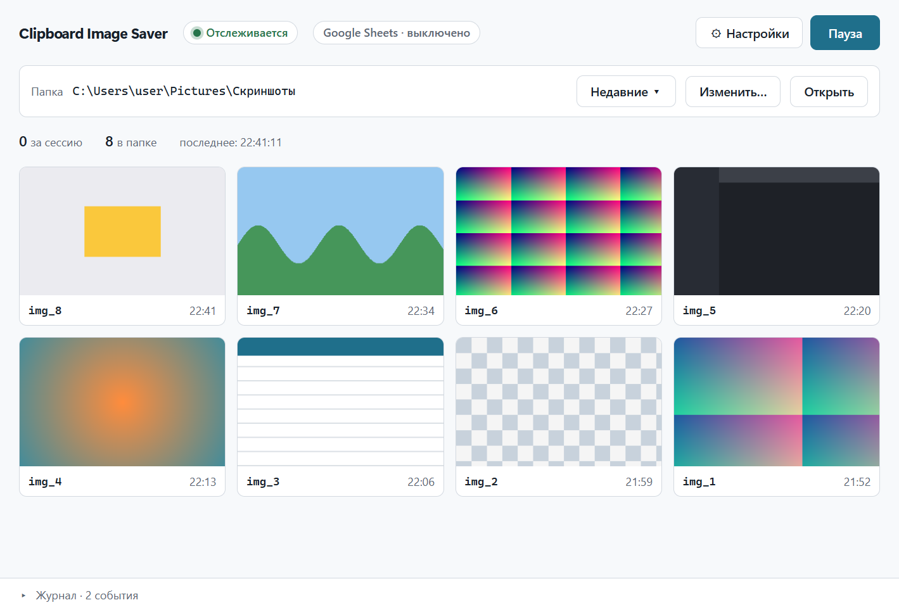
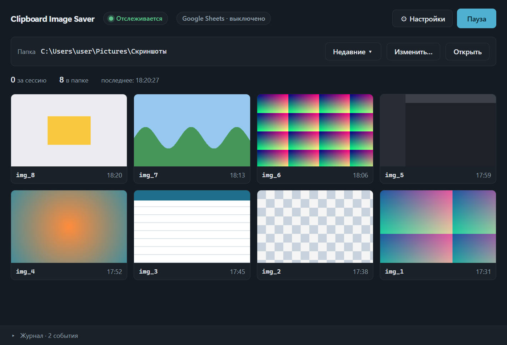

# Clipboard Image Saver

A small Windows app that watches the clipboard and saves every new image (screenshots, copied pictures) to a folder you pick, as `img_1.png`, `img_2.png`, and so on. It can also upload each image to Google Drive and drop it into a Google Sheet as an `=IMAGE()` formula.

Built with Electron. Installs per user, lives in the tray and updates itself from GitHub Releases.

## Screenshots

Screenshots will be refreshed for version 2:




## Install

1. Open [Releases](https://github.com/MaKaYar/clipboard_manager/releases) and download the latest `ClipboardImageSaver-Setup-<version>.exe`.
2. Run it. The installer isn't code-signed, so Windows SmartScreen may show "Windows protected your PC". Click **More info**, then **Run anyway**.
3. The app installs for the current user only (no admin rights needed) and adds Start menu and desktop shortcuts.

## Updates

On startup and every 4 hours the app checks GitHub Releases. When a new version is available it downloads in the background, and a banner offers to restart and install it. If you skip the restart, the update installs the next time you quit the app.

## Usage

1. Click **Изменить…** and choose a folder (the UI is in Russian). Recent folders are under **Недавние ▾**.
2. Click **Старт**. Whatever is already on the clipboard is ignored; only images copied after that are saved.
3. Copy or screenshot images (for example `Win+Shift+S`). Each new image appears in the gallery. The file name continues from the highest `img_<n>.png` already in the folder.
4. **Пауза** stops watching. Right-click a card to open, copy, show it in the folder, or resend it to Sheets.

Closing the window hides the app to the tray (you can turn this off in **Настройки**). The tray icon is blue while watching and grey while paused. Settings also cover launch at login and a notification on each save. If a folder is set, watching starts automatically when the app launches.

## Google Sheets sync (optional)

After each save, the app uploads the image to Google Drive, makes it readable by anyone with the link, then finds the first cell on the chosen sheet whose text contains the search term (default `add`, case-insensitive) and replaces it with `=IMAGE("https://drive.google.com/uc?export=view&id=<file id>")`. Each image takes one cell, so put the search term in every cell you want filled.

Set it up in **Настройки** and pick one of two auth modes:

- **OAuth (your Google account)**: in [Google Cloud Console](https://console.cloud.google.com/) enable the Google Sheets API and Google Drive API, create an OAuth client ID of type *Desktop app*, download its JSON and select it in the app. On first use a browser window opens for you to sign in. The token is saved and refreshed automatically.
- **Service account**: create a service account, download its JSON key and select it in the app. Share the spreadsheet (and the Drive folder, if you set one) with the service account's email as an editor.

Other fields:

- **Spreadsheet**: the full URL or just the ID.
- **Sheet name**: the tab name, `Sheet1` by default.
- **Search term**: the text that marks the target cells.
- **Drive folder ID**: optional. Uploads go here instead of the Drive root.

The app requests only the `spreadsheets` and `drive.file` scopes. If no cell with the term is left, the image is still saved locally and its card shows an error with a retry option.

Settings from the old Python version (`google_sync.json`, `google_token.json`) are imported on first run.

## Where settings live

Everything is stored in `%APPDATA%\Clipboard Image Saver`: `settings.json` holds the folder, recent folders, options and Google config, and `google-token.json` holds the OAuth token. Nothing is written next to the exe. Uninstalling leaves this folder in place, so delete it by hand for a clean reset.

## Development

Requires Node.js 22+ on Windows.

```powershell
npm ci            # install dependencies
npm start         # run the app
npm test          # unit tests (node --test test/unit/)
npm run test:e2e  # end-to-end tests with Playwright (launches Electron)
npm run dist      # build the installer into dist/ (no publish)
```

Set the `CIS_USER_DATA` environment variable to use a different settings folder, which helps with testing.

Icons in `build/` are generated by `npx electron scripts/make-icons.js`.

## Releases

Every push to `main` runs `.github/workflows/build.yml` on `windows-latest`. It runs the tests, sets the version to `1.0.<run number>`, builds the NSIS installer and publishes it with `latest.yml` as GitHub release `v1.0.<run number>`. That release is what the auto-updater picks up. Pull requests build the installer without publishing and attach it as a workflow artifact.

The workflow needs `contents: write` (already set) to create releases with `GITHUB_TOKEN`.

## Project layout

- `src/main/`: Electron main process (watcher, settings, Google sync, updater, gallery).
- `src/preload.js`: the `window.api` bridge.
- `src/renderer/`: UI (plain HTML/CSS/JS).
- `test/unit/`, `test/e2e/`: tests.
- `build/`: app and tray icons.
